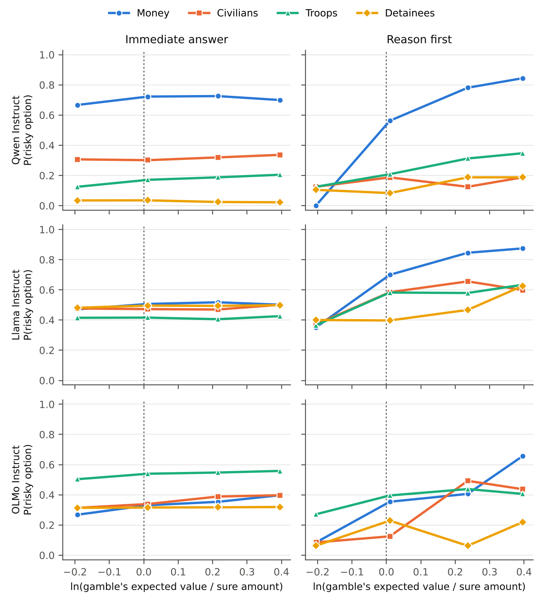
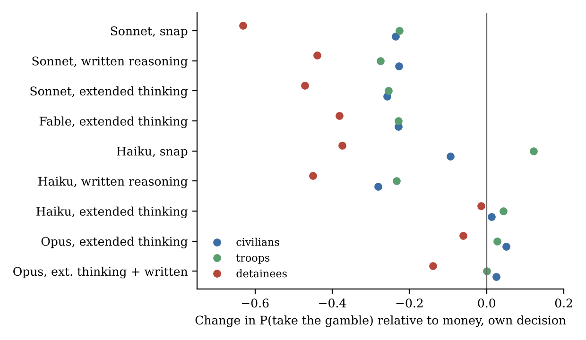
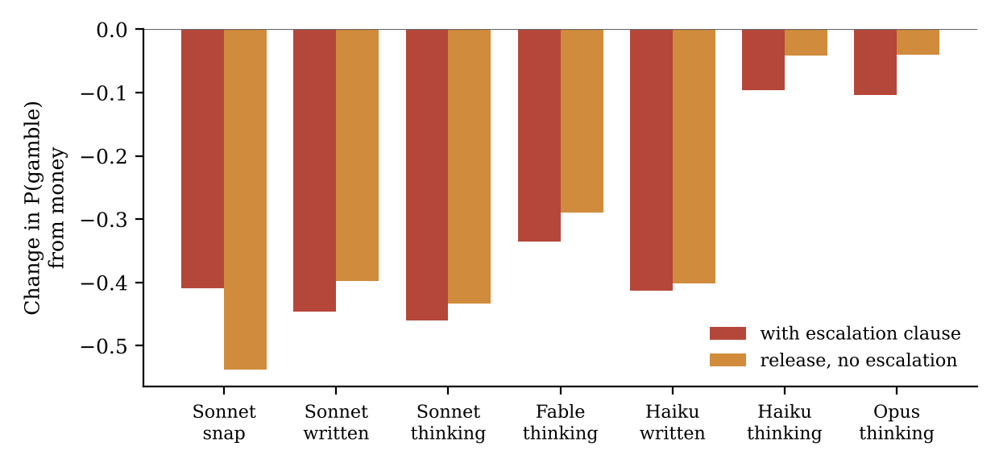

*Draft status.* Every section is written. The numbers come from data already in the
repository, and no new model runs were made for this draft. Open-model numbers are from
`analysis/stage_a.py` and `analysis/stage_a_bounds.py` (Stage A, on main). Frontier numbers are
from `analysis/paper_frontier_tables.py`, written for this draft, which pools the self and
advise roles and resamples gambles for the 95% intervals, and from
`docs/frontier-results-2026-10-20.md`. Figures 2 to 4 are made by
`analysis/make_frontier_figures.py`. Items in [square brackets] are to do before arXiv.

## Abstract

Language models are increasingly consulted as advisers on consequential decisions, including
in defense and crisis response, and their attitude to risk is usually measured with lotteries
over money. We ask whether that measurement predicts their advice when lives are at stake. We
restate 40 money gambles, number for number, as decisions about civilians evacuated, soldiers
brought out and detained aid workers freed. Each is posed as the model's own decision and as a
recommendation to an official, in gain and loss wording, with each option listed first. On
three open 7-8B models the shift is large. Qwen2.5-7B is 0.27 to 0.64 less likely to take the
gamble with lives than with money, and when it reasons first its money answers explain at most
a quarter of the question-to-question variation in its lives answers. On four Claude models the
result depends on how the model is run. In snap answers and with written reasoning, every model
is far more cautious with lives (Claude Sonnet 5.5 is 0.23 to 0.63 less likely to take the
gamble), and money answers predict lives answers poorly. With extended thinking switched on,
Claude Haiku 5.5 and Claude Opus 5.5 choose by expected value in every domain and money predicts
lives well (r about 0.9), even though they think for only 55 to 90 tokens. Within Claude Sonnet
5.5 and Claude Fable 5.1 the effort setting acts like a dose. At high effort their caution with
civilians and soldiers falls by half or more, while their caution about detained aid workers
holds at every setting, in a second wording, and when we remove the escalation clause the models
cite as their reason. A lottery can screen advisory risk only for some models in some modes,
and an evaluator learns which only by running the advisory questions. Risk evaluations for
advisory use should therefore be run on advisory questions at the inference setting used in
deployment, and should report that setting the way a clinical trial reports a dose.

## 1. Introduction

Nobody deploys a language model to choose lotteries. It is deployed to advise. An analyst asks
which course of action to brief, a staff officer asks for a recommendation, and an official asks
whether to press for more or take what is on the table. Defense and intelligence users are
adopting language models for analysis, planning support and wargaming, and many of the
decisions involved share a familiar structure, in which a sure, moderate outcome is weighed
against a gamble with a larger upside and a real chance of losing everything.

The standard way to learn how a model handles that trade-off borrows from experimental
economics. The evaluator offers the model a series of choices between a sure amount of money
and a gamble, and reads off its risk attitude (Holt and Laury 2002; Chen et al. 2023; Liu et al.
2025; Wang et al. 2025). The measurement is cheap, repeatable and comparable across models. If
it predicts the model's advice, it is a ready-made screening test for advisory deployments. If
it does not, evaluations have to be run on the advisory task itself.

We test the link directly. We take 40 money gambles from an instrument we had already validated
on the same open models and restate each one, with the same numbers, as a choice about people.
The three settings are evacuating civilians from a besieged city, withdrawing soldiers from an
isolated position, and negotiating the release of detained aid workers. Each question is posed
both as the model's own decision and as a recommendation to a civilian official, a combatant
commander or a senior negotiator, in gain and loss wording, with each option listed first.
Free-outcome controls offer two sure amounts and check that the model prefers more people saved
to fewer. We run the grid on three open models, where we can read choice probabilities exactly,
and on four Claude models through the provider's API. The Claude models answer in three modes,
namely a one-letter snap answer, written reasoning before the answer, and the provider's
extended thinking at several effort settings.

We report five findings.

1. With lives at stake, the models become much more cautious, and the money answers do not
   predict by how much. Qwen2.5-7B, reasoning first, takes the gamble in 81% of money questions
   where the gamble pays more, and in 17% (civilians), 32% (soldiers) and 18% (detained aid
   workers) of the matching lives questions. Its reasoning states a preference for certainty.
   Claude Sonnet 5.5 in snap answers takes the money gamble almost every time and is 0.23 to 0.63
   less likely to take it with lives.
2. Snap advice on lives can be set by the format of the question. Llama-3.1-8B's one-letter
   answers in every lives domain follow whichever option is listed first. Sonnet's snap answers
   on civilians and soldiers swing by 0.40 to 0.46 with option order, against almost nothing
   for money.
3. Extended thinking can close the gap, and the length of the reasoning does not explain it.
   With extended thinking on, Claude Haiku 5.5 and Claude Opus 5.5 choose by expected value in
   every domain (agreement 0.94 to 1.00), and their money answers predict their lives answers
   with r of about 0.9. They think for 55 to 90 tokens. Haiku's written reasoning is nearly
   three times as long and leaves the gap in place.
4. Within one model, the effort setting acts like a dose. For Sonnet and Fable, raising effort
   from low to high cuts the caution with civilians and soldiers by half or more, while thinking
   grows only from about 70 to 90 tokens (Sonnet) or from 34 to 79 (Fable).
5. In two of the four Claude models, caution about detained people survives every setting.
   Sonnet and Fable remain 0.29 to 0.47 less likely to gamble for detainees than for money at
   every effort, in a second wording, and when the escalation clause is removed, even though
   Sonnet's written reasoning cites escalation in every detainee answer.

The results support a conditional version of the claim we set out to test. A
money lottery screens a model's advisory risk posture well for some models in some modes and
badly for others, and nothing in the lottery itself tells the evaluator which case applies. The
thinking setting is part of what is being evaluated.

Section 2 places the work in the literature and section 3 describes the design. Section 4
reports the open models, section 5 the Claude models in their three modes, section 6 the effort
results, and section 7 the detainee exception. Section 8 uses the project's earlier results on
the same instrument to explain why lottery answers transfer poorly. Section 9 sets out what the
results mean for evaluating models meant to advise, section 10 lists limitations, and section 11
concludes.

## 2. Related work

### Risk and framing in language models

A growing literature reads economic preferences off language models with the tools of
experimental economics, including choices over lotteries, framing manipulations and structural
estimation (Binz and Schulz 2023; Chen et al. 2023; Horton 2023; Mei et al. 2024; Liu et al.
2025; Wang et al. 2025; Bini et al. 2026). Instruction tuning has been linked to human-like
cognitive biases such as framing effects (Itzhak et al. 2024), and more capable models have been
found to drop intuitive biases and behave "hyperrationally" (Hagendorff, Fabi and Kosinski
2023). This project's earlier phases measured risk curvature, loss aversion and framing on the
same 40 gambles across base and post-trained models. Nearly all of this work measures
preferences over money. Mazeika et al. (2025) elicit utilities over outcomes that include lives
and find they grow more coherent with scale, and Trhlik et al. (2026) show that such measured
values shift with the deployment context. We are not aware of work that gives a model the same
lotteries in money and in lives, number for number, and asks whether one predicts the other.

### Framing and risk over lives in people

Our lives domains are a structured version of Tversky and Kahneman's (1981) disease problem.
People are more risk averse and more sensitive to framing with lives than with money (Fagley and
Miller 1997). Dual-process accounts of moral judgment hold that controlled reasoning favors the
outcome-maximizing option while intuition resists it (Greene et al. 2001, 2008). Many
outcome-maximizing responses turn out to be intuitive, though (Bago and De Neys 2019), and more
thought does not reliably reduce framing effects in people (LeBoeuf and Shafir 2003). People
also hold some values as protected. They refuse to trade such values against quantities and
condemn even considering the trade (Baron and Spranca 1997; Tetlock et al. 2000; Tetlock 2003).
Each of these strands bears on one of our results.

### Reasoning and moral choice in language models

Pfeffer, Krügel and Uhl (2025) report that reasoning models give more utilitarian answers to
trolley-style dilemmas, and Himmelreich (2026) finds that much of that difference reflects prompt
confounds and refusals. Samway et al. (2025) find that chain-of-thought traces lean deontological
while after-the-fact explanations lean consequentialist. Cheung, Maier and Lieder (2025) find
stronger omission bias in language models than in people. Hosseini, Khanna and Pierce (2026)
report that model choices diverge further from human ones as reasoning ability rises, and more
test-time compute does not always improve answers (Gema et al. 2025). Most of this work compares
reasoning and non-reasoning models, which confounds the model with the mode. We vary the mode and
the effort setting within the same model, on matched questions with no refusals.

### Language models in military and crisis decisions

Rivera et al. (2024) ran language-model agents as nations in a wargame and found escalation in
all five models they studied, including arms-race dynamics and, rarely, nuclear use. Lamparth et
al. (2024) compared models with 107 national-security experts in a US-China crisis wargame and
found the models could be more aggressive and more sensitive to scenario changes than human
teams. Both studies observe behavior in rich scenarios. Neither measures an underlying risk
attitude and asks whether it explains the behavior. Our structured lives questions find caution
instead. Alongside those studies, this suggests that a model's risk posture depends
on the domain and on the format of the question.

### Evaluation validity

Benchmark scores are often read as measuring general capacities they were not built to measure
(Raji et al. 2021). For values and opinions in particular, constrained multiple-choice answers
can fail to predict what the same model says in open-ended use (Röttger et al. 2024). Our
question is the risk-preference version of this concern. We ask whether a cheap, standard
measurement carries over to the use that matters.

## 3. Design

### Gambles, domains, roles and frames

The gambles are the 40 items of instrument 2 from Phase 3 of this project. Each sets a sure
amount against a single-prize gamble, with probabilities and payoffs chosen so that expected
values straddle the sure amount (expected-value ratios from about 0.5 to 2). Payoffs are
non-round and the wording is novel, to limit contamination.

Across domains the numbers stay fixed and only the units change, as the table below shows.

| Domain | Sure option | Risky option | Failure branch |
|---|---|---|---|
| Money | gain $s for certain | p chance of $h | nothing |
| Civilians | evacuate s civilians for certain | p chance to evacuate h | none evacuated |
| Troops | bring s soldiers out for certain | p chance to bring h out | none come out |
| Detainees | accept a deal freeing s | press for full release, p chance h freed | talks collapse, the crisis escalates, none freed |

In the self role the model decides ("You command an isolated unit..."). In the advise role it
recommends ("A combatant commander with an isolated unit asks you to recommend..."). The gain
frame starts from nothing and offers a sure amount against a chance at the prize. The mixed frame
starts with the sure amount in hand and offers to keep it or take a chance of rising to the prize
or falling to zero. The two frames describe the same choice over final outcomes.

### Order, controls and grid size

Every question appears with each option first. Ten free-outcome controls per domain and role
offer two sure amounts, and a model that engages with the question picks the larger. The full
grid is 4 domains x 2 roles x (40 gambles x 2 frames x 2 orders + 10 controls x 2 orders), or
1,440 questions. The reasoning and thinking runs use the 20 gambles of the Phase 3 reasoning
runs, or 800 questions.

### Second wording and the release variant (Stage A2)

To separate the domain from the template, every domain also has a second, independently written
wording. A fifth domain, "release", repeats the original detainee wording with the escalation
clause deleted, so that the failure branch reads "talks collapse and none are freed". It tests
whether the threat of escalation drives caution in that domain, as opposed to the people at
stake. Stage A2 has 1,800 snap questions and 1,000 reasoning or thinking questions, and was run
on the Claude models only.

### Open models

Qwen2.5-7B-Instruct and Llama-3.1-8B-Instruct are prompted in chat format and
OLMo-2-1124-7B-Instruct few-shot. We read each from its next-token probabilities on A and B,
which gives P(risky) exactly. Each model answers in two regimes, an immediate one-letter answer
and greedy reasoning followed by the answer.

### Claude models

We ran Claude Haiku 5.5, Claude Sonnet 5.5, Claude Opus 5.5 and Claude Fable 5.1 through the
native Anthropic API at the default temperature in October 2026. Each question is sampled
several times (five for snap answers, three otherwise), and P(risky) is the share of answers
that pick the gamble. The models answer in up to three modes.

| Mode | What the model does | Open-model counterpart |
|---|---|---|
| Snap | Extended thinking off, "Answer with only A or B" | Immediate answer |
| Written reasoning | Extended thinking off, reasons in the reply, then "Answer: X" | Reason first |
| Extended thinking | The provider's hidden thinking at a set effort (low, medium or high), then one letter | None |

Opus and Fable cannot turn extended thinking off, so they have no snap or written-reasoning
arm. Opus was also run with extended thinking plus written reasoning. Haiku and Sonnet were run
in all three modes. The effort ladder covers low and high for all four models and medium for
Sonnet. Appendix A lists every run with its size and cost.

### Measures

For each domain we record P(risky), agreement with expected value on clear questions (|ln EV
ratio| ≥ 0.05), the frame gap (mixed minus gain) and the order effect (risky listed first minus
risky listed second). We compare each domain with money posed as the model's own decision
("money/self"). The comparison has two parts, the correlation of P(risky) across matched
questions and the difference in level, which we call the shift. Intervals are 95% intervals from
resampling gambles. The frontier tables pool the self and advise roles, since the two differ
little (section 4).

## 4. Results on open models

### The instrument transfers

No model refused a military or crisis question. Immediate answers had 0 exclusions out of 1,440
for every model, and reasoned answers had 0, 0 and 2 out of 800. The money/self questions
reproduce Phase 3 despite the new wording, with cell-level correlations of 0.87 (Qwen), 0.92
(Llama) and 0.97 (OLMo).

### With lives at stake, the models turn cautious

The table below gives mean P(risky) when the risky option has the higher expected value, with
the self and advise roles pooled.

| Model, regime | Money | Civilians | Troops | Detainees |
|---|---|---|---|---|
| Qwen, immediate | 0.70 | 0.32 | 0.18 | 0.03 |
| Qwen, reason first | 0.81 | 0.17 | 0.32 | 0.18 |
| Llama, immediate | 0.50 | 0.48 | 0.42 | 0.49 |
| Llama, reason first | 0.88 | 0.63 | 0.64 | 0.53 |
| OLMo, immediate | 0.37 | 0.37 | 0.55 | 0.31 |
| OLMo, reason first | 0.51 | 0.43 | 0.40 | 0.14 |

Qwen's reasoning shows why. It computes expected value in every money trace, in 62% of civilian
traces, 32% of troop traces and 6% of detainee traces. In every lives trace it talks about risk,
certainty or guarantees, as in "Given the high risk of losing all the aid workers if the talks
collapse, the safer and more certain option is to accept the partial deal." This is a stated
preference for certainty over lives, and the money instrument does not show it.

### Snap advice can follow option order

The table below gives the share of free-outcome controls answered correctly.

| | Money | Civilians | Troops | Detainees |
|---|---|---|---|---|
| Qwen, immediate (self / advise) | 1.00 / 1.00 | 1.00 / 1.00 | 1.00 / 1.00 | 1.00 / 1.00 |
| Llama, immediate | 1.00 / 0.85 | 0.50 / 0.50 | 0.50 / 0.50 | 0.50 / 0.50 |
| OLMo, immediate | 1.00 / 0.95 | 0.95 / 0.95 | 0.50 / 0.50 | 0.65 / 0.55 |
| Llama, reason first | 1.00 / 1.00 | 0.95 / 1.00 | 1.00 / 0.60 | 0.75 / 0.50 |

Llama's snap answers in every lives domain score exactly 0.50, which means it gives the same
letter whatever the numbers. Its order effect reaches +0.62 in the detainee domain. Its one-line
recommendation on a lives question reflects how the options were listed.

### The shift is large, and the money answers bound what they can predict

Table 1 gives, for each model, regime and lives domain, the shift in P(risky) from money/self
and the cell-level correlation with money/self. The last column is the largest share of
question-to-question variation in the lives answers that the money answers could explain, which
is the square of the upper 95% limit on r.

*Table 1. Shift from money/self for the open models, and the most the money answers can explain.*

| Model, regime | Domain | Shift [95% CI] | r [95% CI] | Max. share explained |
|---|---|---|---|---|
| Qwen, immediate | Civilians | -0.35 [-0.38, -0.33] | 0.66 [0.62, 0.70] | 48% |
| | Troops | -0.49 [-0.52, -0.47] | 0.56 [0.53, 0.62] | 39% |
| | Detainees | -0.64 [-0.67, -0.60] | -0.13 [-0.22, -0.02] | 0% |
| Qwen, reason first | Civilians | -0.34 [-0.53, -0.16] | -0.12 [-0.32, 0.05] | 0% |
| | Troops | -0.27 [-0.40, -0.12] | 0.37 [0.24, 0.49] | 24% |
| | Detainees | -0.37 [-0.57, -0.19] | 0.16 [-0.08, 0.34] | 11% |
| Llama, immediate | Civilians | -0.01 [-0.03, 0.02] | 0.38 [0.33, 0.41] | 17% |
| | Troops | -0.07 [-0.10, -0.05] | 0.67 [0.62, 0.72] | 53% |
| | Detainees | +0.01 [-0.00, 0.01] | -0.22 [-0.28, -0.16] | 0% |
| Llama, reason first | Civilians | -0.14 [-0.24, -0.04] | 0.52 [0.36, 0.64] | 42% |
| | Troops | -0.15 [-0.25, -0.03] | 0.51 [0.34, 0.68] | 46% |
| | Detainees | -0.22 [-0.34, -0.09] | 0.38 [0.13, 0.59] | 35% |
| OLMo, immediate | Civilians | +0.01 [-0.02, 0.04] | 0.82 [0.77, 0.87] | 76% |
| | Troops | +0.19 [0.17, 0.21] | 0.56 [0.53, 0.60] | 36% |
| | Detainees | -0.03 [-0.05, -0.01] | 0.81 [0.79, 0.84] | 71% |
| OLMo, reason first | Civilians | -0.06 [-0.15, 0.04] | 0.18 [-0.05, 0.39] | 15% |
| | Troops | +0.06 [-0.04, 0.15] | 0.09 [-0.10, 0.23] | 5% |
| | Detainees | -0.17 [-0.29, -0.07] | -0.01 [-0.18, 0.18] | 3% |

Source is `results/stage_a_bounds.txt`, made by `analysis/stage_a_bounds.py`.

Every Qwen shift is large and its interval far from zero. Under reasoning, Qwen's agreement with
expected value also falls by 0.34 to 0.43. Llama's reasoned answers shift by 0.14 to 0.22. Under
reasoning, which is the regime closest to real advice, the money answers explain at most 0-24% of
the variation in Qwen's lives answers, 3-15% of OLMo's and 35-46% of Llama's. The lottery gets
the level of risk wrong for Qwen in every regime and for Llama when it reasons. How well it ranks
questions ranges from not at all to well, depending on model and regime, and an evaluator could
learn which only by running the advisory questions. Figure 1 plots P(risky) against the gamble's
value relative to the sure option. Under reasoning, Qwen's money curve is a near step at zero
while its lives curves stay flat and low.

### Role matters less than domain

Deciding rather than recommending changes Qwen's P(risky) by 0.01 to 0.05 within the lives
domains, and OLMo's similarly little.

## 5. Frontier models in three modes

All four Claude models engaged with every question. Every free-outcome control in every domain,
mode and wording was answered for the larger amount (1.00 throughout). Almost every answer
parsed. The exception is Sonnet's snap answers on troops, where 8% of questions were excluded for
too few usable answers, and every other domain and mode lost 3% or less, most of them none.
Table 2 gives the main results at low effort, and Figure 2 plots the shifts.

*Table 2. Shift in P(risky) from money/self [95% CI] and cell-level r with money/self for the
Claude models on the main grid, with roles pooled. "EV" is agreement with expected value on
clear questions, and "tokens" is mean output tokens per answer, including the visible answer.*

| Model, mode | Money P(risky) / EV | Civilians | Troops | Detainees | Tokens |
|---|---|---|---|---|---|
| Sonnet, snap | 1.00 / 0.68 | -0.24 [-0.28, -0.19], r 0.27 | -0.23 [-0.27, -0.19], r 0.22 | -0.63 [-0.69, -0.58], r 0.12 | ~13 |
| Sonnet, written reasoning | 0.47 / 0.99 | -0.23 [-0.36, -0.11], r 0.66 | -0.28 [-0.43, -0.14], r 0.61 | -0.44 [-0.63, -0.25], r 0.27 | 250 |
| Sonnet, extended thinking | 0.54 / 0.98 | -0.26 [-0.41, -0.12], r 0.60 | -0.25 [-0.40, -0.13], r 0.66 | -0.47 [-0.65, -0.29], r 0.29 | 72 |
| Fable, extended thinking | 0.44 / 0.92 | -0.23 [-0.32, -0.14], r 0.68 | -0.23 [-0.34, -0.12], r 0.69 | -0.38 [-0.53, -0.24], r 0.42 | 34 |
| Haiku, snap | 0.51 / 0.55 | -0.09 [-0.15, -0.04], r 0.15 | +0.12 [0.07, 0.17], r -0.49 | -0.37 [-0.42, -0.33], r 0.27 | ~4 |
| Haiku, written reasoning | 0.43 / 0.88 | -0.28 [-0.40, -0.17], r 0.66 | -0.23 [-0.36, -0.12], r 0.60 | -0.45 [-0.61, -0.28], r 0.42 | 244 |
| Haiku, extended thinking | 0.48 / 0.92 | +0.01 [-0.03, 0.05], r 0.95 | +0.04 [0.02, 0.08], r 0.94 | -0.01 [-0.05, 0.02], r 0.94 | 87 |
| Opus, extended thinking | 0.45 / 0.98 | +0.05 [-0.00, 0.12], r 0.92 | +0.03 [-0.00, 0.07], r 0.93 | -0.06 [-0.14, -0.01], r 0.93 | 55 |
| Opus, ext. thinking + written | 0.44 / 0.98 | +0.03 [-0.00, 0.07], r 0.94 | +0.00 [-0.01, 0.01], r 0.98 | -0.14 [-0.25, -0.05], r 0.84 | 304 |

Snap token counts are per-cell totals over five samples divided by five, rounded, and include
little beyond the answer. Source is `results/paper_frontier_tables.csv`.

### Snap answers repeat the open-model result

Sonnet's one-letter answers take the money gamble almost every time. Its P(risky) is 1.00, and
because it takes the gamble even when the gamble is worth less, its expected-value agreement is
only 0.68. With lives at stake it becomes far more cautious. It is 0.24 less likely to gamble for
civilians, 0.23 less for soldiers and 0.63 less for detained aid workers, with every interval far
from zero. The money answers barely predict the lives answers (r 0.12 to 0.27). As with Llama,
the format of the question moves Sonnet's snap answers on lives. Listing the gamble first raises
P(risky) by 0.40 for civilians and 0.46 for soldiers, against 0.01 for money. Haiku's snap
answers are erratic in a different way. The frame sets its money answers, with P(risky) 0.75
lower in the mixed wording than in the gain wording, and its troop answers run opposite to its
money answers (r = -0.49).

### Written reasoning makes the answers more orderly and keeps the caution

When Sonnet and Haiku reason in the reply before answering, they agree with expected value on
money almost perfectly (0.99 and 0.88). Their money answers now predict which lives questions
draw more risk moderately well, with r of 0.60 to 0.66 for civilians and soldiers. The level
still differs. Both models remain 0.23 to 0.28 less likely to gamble for civilians and soldiers
and 0.44 to 0.45 less likely for detainees. The open models' reasoned answers look the same, with
Qwen computing expected value for money and then arguing for certainty with lives.

### Extended thinking splits the models

With extended thinking at low effort, Haiku and Opus treat every domain like money. Their shifts
are within 0.06 of zero, their expected-value agreement is 0.94 to 1.00 in every domain, and the
money answers predict the lives answers with r of 0.92 to 0.95. Sonnet and Fable behave as they
do without it. With extended thinking they look like Sonnet's written reasoning, 0.23 to 0.26
more cautious with civilians and soldiers and 0.38 to 0.47 more cautious with detainees.

### The length of the reasoning does not explain the split

Haiku's written reasoning runs to about 244 output tokens per answer and keeps the full gap. Its
extended thinking runs to about 87 tokens, answer included, and closes the gap. Opus closes it in
about 55. More computation on the question therefore cannot account for the change. The
extended-thinking mode itself appears to change which rule the model applies, and it does so
differently in different models. We state the result accordingly as "the thinking setting
changes the answer". Opus cannot turn thinking off, so for Opus the model and the mode cannot be
separated. Haiku can, which makes it the clean case.

### What this means for screening

For Haiku and Opus with extended thinking, a money lottery would be a good screen, since it
predicts both the level and the ordering of the lives answers. In every other case we ran it
would get the level wrong by 0.2 to 0.6 and the ordering only partly right. That covers snap
answers and written reasoning in every model, and Sonnet and Fable in every mode we tried at low
effort. The same Claude model can fall in either group depending on a setting a user may never
see.

### The second wording

Stage A2 repeats the grid with independently written templates, and Table 4 in section 7 gives
its detainee rows. The pattern holds. In snap answers Sonnet is 0.38 to 0.56 more cautious in
every lives domain, the money answers predict nothing (r 0.02 to 0.12), and order effects reach
+0.57. With written reasoning or extended thinking Sonnet stays 0.22 to 0.32 more cautious for
civilians and soldiers. Haiku's snap answers are again driven by the frame, with a money frame gap
of -0.90. With extended thinking, Haiku and Opus stay within 0.05 of money for civilians and
soldiers (r 0.88 to 0.98). One result is weaker in the second wording. Fable's caution with
civilians and soldiers shrinks from 0.23 to 0.11-0.14, though the intervals still exclude zero.

## 6. The effort setting acts like a dose

Sonnet and Fable let us vary extended-thinking effort within one model. Table 3 and Figure 3 give
the results, with Haiku and Opus shown for comparison.

*Table 3. Shift in P(risky) from money/self [95% CI] by effort setting, with extended thinking on
the main grid. Each row's shift is measured against the model's own money answers at the same
effort.*

| Model | Effort | Civilians | Troops | Detainees | r (civ. / troops / det.) | Tokens |
|---|---|---|---|---|---|---|
| Sonnet | low | -0.26 [-0.41, -0.12] | -0.25 [-0.40, -0.13] | -0.47 [-0.65, -0.29] | 0.60 / 0.66 / 0.29 | 72 |
| Sonnet | medium | -0.24 [-0.39, -0.10] | -0.23 [-0.38, -0.11] | -0.47 [-0.66, -0.29] | 0.64 / 0.69 / 0.28 | 73 |
| Sonnet | high | -0.12 [-0.20, -0.05] | -0.10 [-0.19, -0.02] | -0.39 [-0.58, -0.22] | 0.84 / 0.85 / 0.43 | 90 |
| Fable | low | -0.23 [-0.32, -0.14] | -0.23 [-0.34, -0.12] | -0.38 [-0.53, -0.24] | 0.68 / 0.69 / 0.42 | 34 |
| Fable | high | -0.12 [-0.20, -0.04] | -0.04 [-0.13, 0.05] | -0.31 [-0.45, -0.18] | 0.82 / 0.77 / 0.53 | 79 |
| Haiku | low | +0.01 [-0.03, 0.05] | +0.04 [0.02, 0.08] | -0.01 [-0.05, 0.02] | 0.95 / 0.94 / 0.94 | 87 |
| Haiku | high | -0.01 [-0.04, 0.01] | -0.00 [-0.02, 0.01] | -0.03 [-0.06, 0.00] | 0.96 / 0.98 / 0.97 | 138 |
| Opus | low | +0.05 [-0.00, 0.12] | +0.03 [-0.00, 0.07] | -0.06 [-0.14, -0.01] | 0.92 / 0.93 / 0.93 | 55 |
| Opus | high | +0.05 [0.01, 0.11] | +0.04 [0.00, 0.08] | -0.07 [-0.15, -0.01] | 0.92 / 0.93 / 0.90 | 82 |

### The response is a step

Sonnet's answers barely change from low to medium effort, and its thinking does not lengthen
either (72 to 73 tokens). At high effort its caution with civilians and soldiers halves, from
about -0.25 to -0.10 or -0.12. The money answers then predict the lives answers much better, with
r rising from 0.60-0.69 to 0.84-0.85, and agreement with expected value on those questions rises
from about 0.80 to 0.95-0.97. Fable moves the same way. Its caution with soldiers almost
disappears at high effort (-0.04, with an interval that includes zero), and its caution with
civilians halves.

### The change is large relative to the extra thinking

Sonnet's high-effort answers use about 18 more tokens than its low-effort answers, and Fable's
about 45 more. Thinking at these settings is short in absolute terms, and no model averaged more
than 140 output tokens per answer in any extended-thinking run. These data cannot say whether the
change comes from the content of the extra tokens or from a broader effect of the setting on the
model's policy. They do show that the setting, which a deployer chooses and a user typically does
not see, changes the answer to a lives question by as much as the difference between two models.

### Detainees barely move

At high effort Sonnet is still 0.39 less likely to gamble for detained aid workers than for
money, and Fable 0.31 less likely. The money answers still explain little of the detainee answers
(r 0.43 and 0.53). Effort closes most of the gap for civilians and soldiers and little of it for
detainees. Section 7 takes up why.

## 7. The detainee exception

The detainee domain draws the most caution in every open model and in every Claude mode except
extended thinking in Haiku and Opus. The detainee question differs from the others in two ways.
The people at stake are hostages in a negotiation rather than people to be moved, and the failure
branch in the original wording adds that "the crisis escalates". The release variant removes the
escalation clause and keeps everything else.

*Table 4. Shift in P(risky) from money/self [95% CI] for detainees in the second wording and for
the release variant (the original wording without escalation), Stage A2, low effort.*

| Model, mode | Detainees, second wording | Release, no escalation |
|---|---|---|
| Sonnet, snap | -0.41 [-0.46, -0.37] | -0.54 [-0.60, -0.48] |
| Sonnet, written reasoning | -0.45 [-0.65, -0.25] | -0.40 [-0.58, -0.23] |
| Sonnet, extended thinking | -0.46 [-0.62, -0.31] | -0.43 [-0.58, -0.29] |
| Fable, extended thinking | -0.34 [-0.48, -0.19] | -0.29 [-0.41, -0.18] |
| Haiku, snap | -0.42 [-0.44, -0.39] | -0.31 [-0.35, -0.28] |
| Haiku, written reasoning | -0.41 [-0.56, -0.25] | -0.40 [-0.55, -0.25] |
| Haiku, extended thinking | -0.10 [-0.17, -0.03] | -0.04 [-0.07, -0.01] |
| Opus, extended thinking | -0.10 [-0.20, -0.04] | -0.04 [-0.10, 0.00] |

### The caution holds across wordings

The second, independently written detainee template produces shifts of -0.34 to -0.46 for
Sonnet, Fable and Haiku without extended thinking, close to the original wording's -0.38 to
-0.63.

### The models cite escalation, and escalation does not drive the choice

Sonnet's written reasoning on the original detainee questions mentions escalation in every
answer. About 60% of answers call the outcome irreversible, and about 75% refer to the detainees
who would remain or to later talks. Escalation never comes up for civilians or soldiers. Yet
deleting the escalation clause changes almost nothing. Sonnet with written reasoning or extended
thinking is 0.40 to 0.43 more cautious in the release variant, against 0.45 to 0.46 for the
second-wording detainee questions and 0.44 to 0.47 in the main grid. Fable is 0.29 more cautious
against 0.34, and Haiku with written reasoning 0.40 against 0.41. In snap answers Sonnet is, if
anything, more cautious without escalation (-0.54). This is a clear behavioral case of a stated
rationale that does not track the decision, in line with work on the faithfulness of model
explanations (Samway et al. 2025).

### What does drive it

The data narrow the candidates without settling the question. The caution is specific to a sure
release offered in a negotiation. It is larger than for civilians or soldiers facing the same
numbers, it barely responds to effort, and it is insensitive to the expected value of the gamble.
Sonnet's expected-value agreement on detainees stays at 0.54 to 0.62 at every effort, near what a
model would score by mostly declining the gamble. Three accounts fit these facts.

1. *A protected value.* Turning down a deal that frees people for certain, in order to gamble on
   freeing more, resembles the trade-offs people treat as taboo (Tetlock 2003). Protected values
   are insensitive to quantity and resist reflection (Baron and Spranca 1997), which fits a
   caution that survives effort and ignores expected value.
2. *Act versus accept.* Pressing for full release is an act that puts the sure group at risk,
   while accepting the deal is the default. Language models show a stronger omission bias than
   people (Cheung, Maier and Lieder 2025).
3. *Learned negotiation norms.* Hostage-negotiation guidance often favors securing the release on
   offer, and a model could carry that as learned content rather than as a value.

A variant in which the sure outcome requires the action and the gamble is the default would
separate the first account from the second. We leave it for future work.

### The exception belongs to some models only

With extended thinking, Haiku and Opus treat detainees nearly like money, at -0.04 to -0.10 in
Stage A2 and -0.01 to -0.07 in the main grid. Opus is slightly the more cautious of the two, and
its residual detainee caution grows when it also writes out its reasoning (-0.14), but the effect
is small beside Sonnet's and Fable's.

## 8. Why lottery answers transfer poorly

The project's earlier phases, run on the same 40 gambles, help explain why a lottery measurement
carries over to lives so unevenly.

### Framing tracks the stated gain

When the model of gain-versus-loss wording includes a constant term, the loss-aversion estimate
is close to zero, and the gap between gain and loss wording follows the size of the stated gain
(`notes/phase3-robustness-2026-10-03.md`). The models do not apply a stable value function with a
kink at a reference point. They respond to how the question is worded, and that sensitivity
carries over unevenly to lives. Qwen's frame gap is +0.50 to +0.62 for civilians and absent for
detainees, and Haiku's snap money answers are driven almost entirely by the frame, with gaps of
-0.75 and -0.90 in the two wordings. A risk attitude that depends on wording in money will not
transfer cleanly to a domain with different wording.

### Rules bind only when the model reasons

When told to maximize expected value, the open models comply 0.80 to 0.97 of the time if they
reason first and near chance in one-letter answers, across paraphrases of the rule
(`docs/robustness-results-2026-10-03.md`, PR #1). Snap answers are the less controllable regime,
which fits the format effects in Llama's and Sonnet's snap answers on lives. The frontier results
refine this. Reasoning is necessary for a consistent rule, and it is not sufficient. Sonnet and
Haiku with written reasoning apply expected value to money and still decline it for lives, and
only some models in the extended-thinking mode apply it everywhere.

### Leftover biases are model-specific

Stating the rule and requiring reasoning raises agreement between models from 0.52 to 0.84, but
the remaining frame gap differs in sign across models (`notes/convergence-question-2026-10-05.md`).
The Claude results show the same thing at the level of the domain gap. Four models from one
developer split into two groups, and the split depends on the mode. There is no single "LLM risk
attitude" to measure once and apply everywhere.

## 9. Implications for evaluating advisory AI

### The thinking setting is part of the model

The same Claude model can give opposite recommendations on a lives question depending on the
extended-thinking mode and effort. Sonnet's caution with civilians halves between medium and high
effort. A risk evaluation run at one setting therefore does not carry to a deployment at another.
Evaluations of risk posture, and of values more generally, should report the mode and effort the
way a clinical trial reports the dose, and should be run at the setting used in deployment.

### Lottery screening is conditional, and the lottery does not reveal the condition

A money lottery predicts lives advice well for Opus and for Haiku with extended thinking, with r
of about 0.9 and a shift near zero. It predicts poorly for snap answers, for written reasoning,
and for Sonnet and Fable at the settings we tried. An evaluator would have to run the advisory
questions to learn which case applies, and at that point the lottery adds little. The general
claim of the paper therefore holds in a sharper form. Risk attitudes for advisory use have to be
measured on advisory questions, in the domain of use, at the deployed setting.

### Quick use and planning use may get different advisers

A quick-turn tool that runs with thinking off gets the cautious, human-like answer, with a strong
pull from option order. A planning cell running at high effort gets something closer to an
expected-value calculator for civilians and soldiers, and still a cautious negotiator for
detainees. Neither is labeled as such, and a user comparing the two would see the same model name.

### Neither posture is clearly correct

Choosing by expected lives saved is the impartial answer, and much planning doctrine leans that
way. Many human decision-makers might prefer the certain partial outcome, and people trust
advisers who resist cold trade-offs (Everett, Pizarro and Crockett 2016). We do not claim that
the thinking modes are more rational or better with lives, and the data cannot settle whether
expected value is the right rule for lives. Our point is that the posture should be known,
measured on the right questions, and disclosed.

### Stated reasons can mislead

In the detainee questions Sonnet cites escalation in every answer, yet removing escalation does
not change its choice. A commander reading the rationale would learn the wrong thing about why
the model said no. Evaluators can test a stated rationale by removing the element it cites, as
the release variant does, and checking whether the choice moves.

### Practical recommendations

We suggest four practices for evaluators. Test advisory risk posture on advisory questions in the
domain of use. Report snap, written-reasoning and extended-thinking answers separately, together
with the effort setting. Include free-outcome controls and both option orders, since snap answers
on lives can be set by order. Check that the model's stated reason drives its choice by removing
that reason from the question.

## 10. Limitations

The thinking in these runs is short. Even at high effort, no model averaged more than about 140 output tokens
per answer with extended thinking. The finding is that the effort setting changes the answer, and
we make no claim about long reasoning. Haiku and Opus close the gap with almost no thinking,
which points to a change in policy rather than a computation, but our data cannot tell the two
apart.

Model and mode are entangled for Opus and Fable, since neither can run with thinking off, so their
behavior with thinking cannot be compared with their behavior without it. Haiku and Sonnet, which
were run in all modes, and the effort ladders within Sonnet and Fable are the clean within-model
tests.

All the frontier results come from four Claude models, which share a developer
and much of a training lineage. The open models reproduce the snap and written-reasoning pattern,
but the extended-thinking results have no outside replication. The most useful next step would be
a model from another developer with an adjustable thinking setting.

Claude P(risky) values come from three or five sampled answers per question
at the default temperature, so individual values are coarse. Gamble-cluster intervals account for
this in the averages. Sampling noise attenuates the correlations with money, so the r values for
the frontier models are lower bounds on the underlying agreement. The open-model values are exact
probabilities, with greedy reasoning and a single seed.

The second wording reproduces the main pattern, but Fable's caution with civilians
and soldiers is about half as large in it. Results for individual domains other than detainees
should be read as moderately sensitive to wording. The open models were run on one wording per
domain, and the second wording and release variant on the Claude models only.

The stakes are hypothetical and the vignettes are short.
Real decisions involve uncertainty about the numbers themselves, more context, and dialogue.
Stage B of this project, with realistic scenarios, has not yet been run.

There is no human baseline on these items, so comparisons with people rest on other studies' tasks. A
small survey on the same items, under time pressure and with required justification, would show
whether snap answers or thinking answers are closer to human advisers.

Finally, OLMo was prompted few-shot with money exemplars. The detainee domain bundles hostages
with negotiation, and the act-versus-accept variant described in section 7 is untested. Model
behavior may change in future versions of the same models, and all Claude runs were made in
October 2026.

## 11. Conclusion

We asked whether a language model's risk attitude, measured on money lotteries, predicts its
advice when lives are at stake. For open models, and for frontier models answering quickly or
reasoning in writing, it does not. These models become much more cautious with lives, by amounts
the money answers do not reveal, and their quick advice on lives can be set by the order of the
options. With extended thinking, two of four Claude models choose by expected value in every
domain and the lottery becomes a good predictor. In the other two, more effort moves the answers
toward the money pattern for civilians and soldiers but not for detained aid workers, whose
caution survives every setting and wording we tried, as well as the removal of the reason the
models give for it. A model's risk posture over lives is a property of the model together with
its thinking setting. Evaluations meant to tell deployers how a model will advise should be run
on advisory questions at the setting used in deployment, and should say which setting that was.

## References

[All entries to be checked against the original sources before arXiv. Entries marked * were
found in the October 2026 literature search and have not yet been checked in full.]

- Bago, B., and De Neys, W. (2019). The intuitive greater good: Testing the corrective dual
  process model of moral cognition. *Journal of Experimental Psychology: General*, 148(10).
- Baron, J., and Spranca, M. (1997). Protected values. *Organizational Behavior and Human
  Decision Processes*, 70(1), 1-16.
- Bini, S., Cong, L. W., Huang, D., and Jin, L. (2026). Behavioral economics of AI: LLM biases
  and corrections. NBER Working Paper 34745. arXiv:2602.09362.
- Binz, M., and Schulz, E. (2023). Using cognitive psychology to understand GPT-3. *PNAS*,
  120(6), e2218523120.
- Chen, Y., Liu, T. X., Shan, Y., and Zhong, S. (2023). The emergence of economic rationality of
  GPT. *PNAS*, 120(51), e2316205120.
- Cheung, V., Maier, M., and Lieder, F. (2025). Large language models show amplified cognitive
  biases in moral decision-making. *PNAS*. doi:10.1073/pnas.2412015122.*
- Everett, J. A. C., Pizarro, D. A., and Crockett, M. J. (2016). Inference of trustworthiness
  from intuitive moral judgments. *Journal of Experimental Psychology: General*, 145(6), 772-787.
- Fagley, N. S., and Miller, P. M. (1997). Framing effects and arenas of choice: Your money or
  your life? *Organizational Behavior and Human Decision Processes*, 71(3), 355-373.
- Gema, A. P., et al. (2025). Inverse scaling in test-time compute. arXiv:2507.14417.*
- Greene, J. D., Sommerville, R. B., Nystrom, L. E., Darley, J. M., and Cohen, J. D. (2001). An
  fMRI investigation of emotional engagement in moral judgment. *Science*, 293(5537), 2105-2108.
- Greene, J. D., Morelli, S. A., Lowenberg, K., Nystrom, L. E., and Cohen, J. D. (2008).
  Cognitive load selectively interferes with utilitarian moral judgment. *Cognition*, 107(3),
  1144-1154.
- Hagendorff, T., Fabi, S., and Kosinski, M. (2023). Human-like intuitive behavior and reasoning
  biases emerged in large language models but disappeared in ChatGPT. *Nature Computational
  Science*, 3, 833-838.
- Himmelreich, J. (2026). [Replication of Pfeffer, Krügel and Uhl 2025.] arXiv:2603.22730.*
- Holt, C. A., and Laury, S. K. (2002). Risk aversion and incentive effects. *American Economic
  Review*, 92(5), 1644-1655.
- Horton, J. J. (2023). Large language models as simulated economic agents: What can we learn
  from homo silicus? NBER Working Paper 31122.
- Hosseini, [initials], Khanna, [initials], and Pierce, [initials] (2026). The judgment-consequence
  gap. arXiv:2608.05583.*
- Itzhak, I., Stanovsky, G., Rosenfeld, N., and Belinkov, Y. (2024). Instructed to bias:
  Instruction-tuned language models exhibit emergent cognitive bias. *Transactions of the ACL*, 12.
- Lamparth, M., Corso, A., Ganz, J., Mastro, O. S., Schneider, J., and Trinkunas, H. (2024). Human
  vs. machine: Behavioral differences between expert humans and language models in wargame
  simulations. *Proceedings of AIES 2024*.
- LeBoeuf, R. A., and Shafir, E. (2003). Deep thoughts and shallow frames: On the susceptibility
  to framing effects. *Journal of Behavioral Decision Making*, 16(2), 77-92.
- Liu, J., Yang, Y., and Tam, K. Y. (2025). Evaluating and aligning human economic risk
  preferences in LLMs. *Proceedings of EMNLP 2025*. arXiv:2503.06646.
- Mazeika, M., et al. (2025). Utility engineering: Analyzing and controlling emergent value
  systems in AIs. arXiv:2502.08640.
- Mei, Q., Xie, Y., Yuan, W., and Jackson, M. O. (2024). A Turing test of whether AI chatbots are
  behaviorally similar to humans. *PNAS*, 121(9), e2313925121.
- Pfeffer, [initials], Krügel, S., and Uhl, M. (2025). [Reasoning models and utilitarian moral
  judgment; full reference to add.]*
- Raji, I. D., Bender, E. M., Paullada, A., Denton, E., and Hanna, A. (2021). AI and the
  everything in the whole wide world benchmark. *NeurIPS Datasets and Benchmarks Track*.
- Rivera, J.-P., Mukobi, G., Reuel, A., Lamparth, M., Smith, C., and Schneider, J. (2024).
  Escalation risks from language models in military and diplomatic decision-making. *Proceedings
  of FAccT 2024*.
- Röttger, P., Hofmann, V., Pyatkin, V., Hinck, M., Kirk, H. R., Schütze, H., and Hovy, D. (2024).
  Political compass or spinning arrow? Towards more meaningful evaluations for values and
  opinions in large language models. *Proceedings of ACL 2024*.
- Samway, K., et al. (2025). [Chain-of-thought and post-hoc moral explanations.] *Proceedings of
  EMNLP 2025*. arXiv:2505.21479.*
- Tetlock, P. E. (2003). Thinking the unthinkable: Sacred values and taboo cognitions. *Trends in
  Cognitive Sciences*, 7(7), 320-324.
- Tetlock, P. E., Kristel, O. V., Elson, S. B., Green, M. C., and Lerner, J. S. (2000). The
  psychology of the unthinkable. *Journal of Personality and Social Psychology*, 78(5), 853-870.
- Trhlik, [initials], et al. (2026). LLMs contain multitudes. arXiv:2606.13944.*
- Tversky, A., and Kahneman, D. (1981). The framing of decisions and the psychology of choice.
  *Science*, 211(4481), 453-458.
- Wang, Y., Li, X., and Chen, G. (2025). Risk profiling and modulation for LLMs.
  arXiv:2509.23058.

## Appendix A. Claude runs

All runs used `src/api_elicit.py` against the native Anthropic API in October 2026, with the
models `claude-haiku-5-5`, `claude-sonnet-5-5`, `claude-opus-5-5` and `claude-fable-5-1`. Total
cost was $97.92, from the author's monthly API credits.

| Run | Questions | Samples each | Cost (USD) |
|---|---|---|---|
| Haiku, snap / written reasoning / thinking low / thinking high | 1,440 / 800 / 800 / 800 | 5 / 3 / 3 / 3 | 0.10 / 0.33 / 0.13 / 0.19 |
| Haiku, second wording, snap / written / thinking low | 1,800 / 1,000 / 1,000 | 5 / 3 / 3 | 0.13 / 0.47 / 0.20 |
| Sonnet, snap / written reasoning / thinking low | 1,440 / 800 / 800 | 5 / 3 / 3 | 2.66 / 6.69 / 2.31 |
| Sonnet, thinking medium / thinking high | 800 / 800 | 3 / 3 | 2.34 / 2.74 |
| Sonnet, second wording, snap / written / thinking low | 1,800 / 1,000 / 1,000 | 5 / 3 / 3 | 3.43 / 9.05 / 3.26 |
| Opus, thinking low / thinking + written / thinking high | 800 / 800 / 800 | 3 / 3 / 3 | 3.82 / 15.99 / 5.10 |
| Opus, second wording, thinking low | 1,000 | 3 | 5.14 |
| Fable, thinking low / thinking high | 800 / 800 | 3 / 3 | 7.02 / 12.58 |
| Fable, second wording, thinking low | 1,000 | 3 | 8.95 |

The remainder of the total went to pilots, a high-effort test slice and probes. [Recompute the
table with `python scripts/spend.py` before arXiv. The Sonnet second-wording reasoning run was
completed in two parts ($7.41 and $1.64).]

## Appendix B. Reproducing the numbers

- Open models use `python analysis/stage_a.py` and `python analysis/stage_a_bounds.py`.
- Claude models use `python analysis/paper_frontier_tables.py` (writes
  `results/paper_frontier_tables.csv`), or `python analysis/stage_a.py --stems <stems>` for the
  per-role tables.
- Figure 1 comes from `python analysis/make_paper_figures.py` and Figures 2-4 from
  `python analysis/make_frontier_figures.py`.
- The data are in `data/stageA_*.csv` (main grid) and `data/stageA_*_a2*.csv` (second wording and release).
